# Scientific Analysis with AI Agent Workspaces — Assignment 3

CMU 11-781 / 02-741 Generative AI for Biomedicine, Fall 2026

**Agent workspace:** Claude Code (Anthropic) running model Claude Opus 5.5, with shell, Python and web access, on a Linux workstation (CPU only; no GPU was used). The agent wrote and ran all code in `submission/*/code/`. Every number in this report was produced by those scripts and can be regenerated with `bash submission/run_all.sh` (see `README.md`).

**How to read this report.** Each claim is tagged as one of three kinds. **[Obs]** is an observation computed from the data in this submission. **[Pred]** is a mechanistic prediction or interpretation. **[Ext]** is evidence retrieved from a database or the literature, with a PMID or accession given.

## Checkpoint evidence index

| ID | Status | Evidence (figure / table / code) |
|---|---|---|
| P1 | complete | §1.1–1.2; Table P1a–P1c; `protein/code/01_map_and_measure.py`; `protein/outputs/table_p1*.csv` |
| P2 | complete | §1.3; Table P2a–P2d; `01_map_and_measure.py`, `02_mechanism_checks.py`; `table_p2*.csv` |
| P3 | complete | §1.4; Table P3 (comparison), Table P1c, paralog/AlphaMissense tables; references |
| P4 | complete | Figure P1 (`fig_p4_annotated_structure.png`, interactive `egfr_4hjo_interactive.html`); Table P3 |
| S1 | complete | §2.1; Fig S1–S2; Table S1; `single_cell/code/01_qc_baseline.py`; `baseline_settings.json` |
| S2 | complete | §2.2; Fig S3; Table S2; `table_s2a–d*.csv` |
| S3 | complete | §2.3; Fig S4; Tables S3a–S3b; `02_resolution_sweep.py`; `table_s3*.csv` |
| S4 | complete | §2.4; Fig S5; Table S4; `03_downsample.py`; `table_s4*.csv` |
| S5 | complete | §2.5; Fig S6; Table S5; `table_s5c/d`; `04_ambiguous_population.py`; `table_s5*.csv` |
| T1 | complete | §3.1; Fig T1 (+ `fig_t1b`); Table T1; `spatial/code/01_expression_domains.py` |
| T2 | complete | §3.2; Fig T3; `table_t2a–d`; `02_spatial_statistics_and_null.py`; `table_t2*.csv` |
| T3 | complete | §3.3; Fig T4; `table_t3a–b`; `03_svg_vs_de.py`; `table_t3*.csv` |
| T4 | complete | §3.4; Fig T5; Table T3 (§3.4); `table_t4b`; `table_t3b_t4_moran_and_DE_rankings.csv` |
| T5 | complete | §3.5; Fig T6–T7; Table T4; `02_spatial_statistics_and_null.py`, `04_depth_confound_check.py` |
| A | complete* | §1.5, §2.6, §3.6 (*student verification boxes must be completed by the student — see README) |
| R | complete | `README.md`, `run_all.sh`, `fetch_data.sh`, `requirements.txt`, seeds in §2.1/§3.1/§3.5 |

# Task 1 — EGFR missense variants G719S, T790M, L858R

## 1.1 Protein and variant verification (P1)

**Protein.** Epidermal growth factor receptor, human, **UniProt P00533 (EGFR_HUMAN)**. The canonical isoform is 1,210 aa, sequence version 2 (last updated 1997-11-01), entry version 301 (retrieved 2026-10-29 from rest.uniprot.org). EGFR is a receptor tyrosine kinase. The variants studied here all lie in the cytoplasmic **protein kinase domain (UniProt 712–979)** **[Ext]**.

**Variant notation** uses canonical UniProt numbering (p. notation, 1-based). The script checks each stated wild-type residue against the UniProt sequence and stops with an error if any does not match **[Obs]**:

| Variant | Canonical position | Stated WT | UniProt residue | Local sequence | UniProt annotation **[Ext]** |
|---|---|---|---|---|---|
| G719S | 719 | G | **G** ✓ | KIKVL**[G]**SGAFG | ATP-binding region 718–726 (Gly-rich loop, GxGxxG motif starts at 719) |
| T790M | 790 | T | **T** ✓ | TVQLI**[T]**QLMPF | ATP-binding 790–791 (gatekeeper / hinge) |
| L858R | 858 | L | **L** ✓ | ITDFG**[L]**AKLLG | 3 residues after DFG (855–857), in the activation segment (DFG 855 … ALE 882) |

*Table P1a. Sequence check (`table_p1a_variant_sequence_check.csv`).* Motif positions were found by string search on the UniProt sequence: GSGAFG at 719, HRDLAARN at 835, DFG at 855, ALE at 882 (EGFR has ALE where most kinases have APE). Catalytic residues named below are K745 (ATP-binding, UniProt), E762 (αC-helix Glu), D837 (UniProt "proton acceptor") and D855 (DFG).

## 1.2 Structures and residue mapping (P1)

The primary structure is **PDB 4HJO, chain A**: EGFR kinase domain bound to erlotinib (ligand AQ4), solved by X-ray at 2.75 Å, in an **inactive** conformation (Park et al. 2012, PMID 23101586) **[Ext]**. All other structures were used only for comparison.

**Mapping method.** For each structure, the full deposited construct sequence (SEQRES, including unresolved residues) was aligned globally to UniProt (BLOSUM62, gap open −10, extend −0.5). Each resolved residue was then placed through its sequence index. A first version aligned only the *resolved* residues, and one C-terminal residue of 2ITX/2ITV was misplaced at a gap; see audit §1.5. **[Obs]**

| Structure | Content | author − canonical | Resolved (canonical) | G719 | T790 | L858 | Mismatches vs UniProt |
|---|---|---|---|---|---|---|---|
| **4HJO** | WT, erlotinib, inactive | **−24** | 703–984 | Gly695 | Thr766 | Leu834 | **Arg924 → canonical V948R (engineered)** |
| 1M17 | WT, erlotinib, active-like (Stamos 2002, PMID 12196540) | −24 | 696–1019 | Gly695 | Thr766 | Leu834 | none |
| 2ITX | WT, AMP-PNP | 0 | 697–1019 | Gly719 | Thr790 | Leu858 | none |
| 2ITN | G719S, AMP-PNP | 0 | 696–1019 | **Ser719** | Thr790 | Leu858 | S719 |
| 2ITV | L858R, AMP-PNP | 0 | 696–1019 | Gly719 | Thr790 | **Arg858** | R858 |
| 2JIT | T790M, apo | 0 | 696–1016 | Gly719 | **Met790** | Leu858 | M790 |
| 4I22 | L858R/T790M/V948R, gefitinib | 0 | 700–1014 | Gly719 | **Met790** | **Arg858** | M790, R858, R948 |
| AF-P00533-F1 v6 | AlphaFold DB model | 0 | 1–1210 | Gly719 | Thr790 | Leu858 | none |

*Table P1b. Mapping (`table_p1b_structure_mapping.csv`).* All three candidate sites are resolved in every structure. Two observations matter for interpretation **[Obs]**:

- **4HJO and 1M17 number residues 24 lower than canonical** (mature-protein numbering after the 24-aa signal peptide), whereas the 2IT*/2JIT/4I22 entries use canonical numbering. Canonical L858 is therefore *Leu834* in 4HJO. In each structure, the only sequence mismatches are exactly the deposited variant residues, which confirms the mapping. The engineered **V948R** in 4HJO lies at the C-lobe asymmetric-dimer interface. It is used to keep the kinase monomeric and inactive (Zhang et al. 2006, PMID 16777603) **[Ext]**. It lies 26.0–30.6 Å from all three candidate sites and 26.8 Å from erlotinib (`table_p2f_V948R_distances_4hjo.csv`).
- **Reliability.** 4HJO has 2.75 Å resolution. The relative B-factors at the three sites are 1.05 (G719), 0.95 (T790) and 0.90 (L858), so none of the sites is unusually mobile. AlphaFold DB (Jumper et al. 2021, PMID 34265844) pLDDT values (Table P1c) are high at T790 (88.4) and moderate at G719 (73.3). At **L858 the pLDDT is only 51.2** (window mean 59.2 vs kinase-domain mean 84.1). This is consistent with the activation loop taking different conformations in different states, and it is why the AlphaFold model is not used for L858 geometry.

| Variant | pLDDT (residue) | pLDDT (±5 window) | Kinase-domain mean |
|---|---|---|---|
| G719S | 73.3 | 75.3 | 84.1 |
| T790M | 88.4 | 83.6 | 84.1 |
| L858R | 51.2 | 59.2 | 84.1 |

*Table P1c. AlphaFold DB v6 confidence (`table_p1c_alphafold_plddt.csv`).*

## 1.3 Structural measurements (P2)

**Measurement rules.** These are stated in the header of `structlib.py`/`01_map_and_measure.py`. All measurements use heavy atoms only, in Å. *min-dist* is the smallest distance between any heavy atom of the site residue and any heavy atom of the target. Neighbours are residues within ≤ 5.0 Å. Relative SASA is computed with freesasa (Lee–Richards, 1.4 Å probe) on the protein chain with ligands and waters removed. αC conformation is read from the minimum K745 NZ – E762 OE1/OE2 distance: < 4 Å means the salt bridge is formed (αC-in, active-like).

| Structure (state) | Site | → ligand | → K745 NZ | → E762 | → D855 (DFG) | → αC helix | rel. SASA | rel. B |
|---|---|---|---|---|---|---|---|---|
| 4HJO (inactive; K–E 13.3 Å) | G719 | 5.06 (AQ4) | 7.78 | 20.35 | 10.02 | 16.5 | 0.35 | 1.05 |
| | T790 | **3.48** (AQ4) | 9.03 | 14.27 | 8.57 | 7.5 | 0.21 | 0.95 |
| | L858 | 5.26 (AQ4) | 3.58 | 6.18 | **2.96** | **4.57** | **0.10** | 0.90 |
| 1M17 (active-like; K–E 3.05 Å) | G719 | 4.50 | 9.57 | 12.41 | 10.89 | 12.3 | 0.37 | 1.44 |
| | T790 | **3.41** | 8.56 | 7.38 | 9.03 | 3.2 | 0.17 | 0.71 |
| | L858 | 10.12 | 8.70 | 6.64 | 5.04 | 6.6 | 0.15 | 0.82 |
| 2ITX (WT, AMP-PNP; K–E 3.58 Å) | G719 | 4.27 (ANP) | 10.17 | 13.10 | 11.93 | 13.0 | 0.35 | 1.54 |
| | T790 | 3.13 | 7.10 | 6.62 | 9.85 | 3.9 | 0.15 | 0.79 |
| | L858 | 6.27 | 10.17 | 6.81 | 4.94 | 6.2 | 0.25 | 1.25 |

*Table P2a (excerpt; all 8 structures × 3 sites in `table_p2a_site_measurements.csv`, all 5 Å neighbours in `table_p2b_neighbours_within_5A.csv`, αC state in `table_p2c_conformation_state.csv`).* **[Obs]**

Variant-specific checks (`02_mechanism_checks.py`, Tables P2d–P2e) **[Obs]**:

- **L858 environment.** In inactive 4HJO, L858 is buried (relative SASA 0.10). It sits in a short activation-loop helix (HELIX record, canonical 857–862) in a mostly hydrophobic 5 Å shell: L747 (4.54 Å), **M766 on the αC helix (4.57 Å)**, L788 (3.64), F856 (3.21), L861 (3.01) and L862 (2.81). The shell also contains three charged residues: K745 (3.21 Å), D855 (2.96 Å) and K860 (3.07 Å) (`table_p2b`). In the αC-in structures (1M17, 2ITX, 2ITN, 2ITV, 2JIT), the same residue is more exposed (SASA 0.15–0.40). Its neighbours there are the HRD/catalytic-loop residues V834, H835, R836 and D837, and it no longer contacts the αC helix. In 2ITV (L858R, active), Arg858 is accommodated next to D837 and Y891. **Counter-evidence:** 4I22 (L858R/T790M/V948R + gefitinib) is itself αC-out (K745–E762 12.2 Å). Arg858 is accommodated there as well: it forms salt bridges to D855 (2.94 Å) and D837 (3.18 Å) and packs against F723, F856, L861 and L862 (`table_p2e`). So Arg858 is *not* incompatible with an inactive conformation, at least with V948R and a bound drug.
- **T790 / T790M.** Thr/Met790 is the closest of the three sites to the bound ligand in all six ligand complexes (4HJO, 1M17, 2ITX, 2ITN, 2ITV, 4I22; 3.1–3.5 Å). Placing *apo* Met790 from 2JIT onto the erlotinib complexes gives Met–drug distances of **0.6–1.3 Å**. That would be a steric clash, and the result holds under both global (264 CA, RMSD 3.65 Å vs 4HJO) and local ATP-pocket superposition (67 CA, 2.75 Å). However, in **4I22**, an experimental drug-bound Met790 structure locally superposed onto 4HJO with an RMSD of 0.49 Å, Met790 sits **3.26–3.46 Å** from the ligand with no clash. So, in the inactive (4HJO) pocket, the clash comes from the apo side-chain rotamer, not from Met790 itself. The same 4I22 side chain placed into the active-like 1M17 pocket (local superposition) comes to 2.52 Å from erlotinib, with 3 ligand atoms within 3 Å (`table_p2d`). That is a near-contact, so the absence of a clash is established only for the inactive state.
- **G719 / G719S.** In 2ITN, the Ser719 OG atom is **5.15 Å** from the nearest AMP-PNP phosphate oxygen (Gly719 CA in 2ITX: 6.78 Å), too far for a direct hydrogen bond to the phosphates. The Ser side chain instead lies near the ribose (OG 3.7–3.8 Å from C5′/O4′). After superposition, the P-loop (718–726) differs from WT 2ITX by a CA RMSD of 0.91 Å (max 1.95 Å; global RMSD 0.82 Å). WT Gly719 has φ = −157° (4HJO) and −119° (2ITX). These are β-region angles that a non-glycine residue can also adopt, so a backbone-strain mechanism is *not* supported.

**Candidate-specific limitations.** (i) 4HJO carries the engineered V948R and is crystallised with erlotinib in an inactive state. Its geometry describes one conformation, not the active enzyme. (ii) The distances to ATP are taken from AMP-PNP (a non-hydrolysable analogue) in structures from a different construct and crystal form, which are not strictly equivalent to 4HJO. (iii) The L858 neighbourhood depends strongly on conformation (pLDDT 51 in AlphaFold), so a single static structure cannot describe it. (iv) The T790M analysis uses an apo structure plus one double-mutant drug complex (4I22; Gajiwala et al. 2013, PMID 23273428), not a single-mutant erlotinib complex. A single-mutant T790M complex with AEE788 (2JIU; Yun 2008) exists but was not analysed. (v) At 2.5–3.5 Å resolution, side-chain positions carry roughly ±0.3–0.5 Å coordinate uncertainty, so distances near cut-offs (e.g., M766 at 4.57 Å) should be treated as approximate.

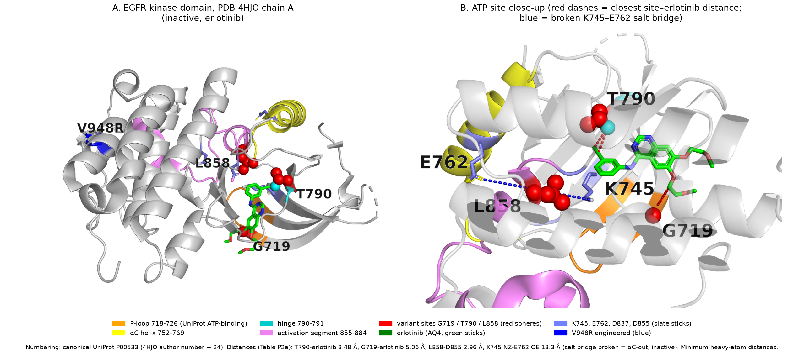

*Figure P1. Annotated EGFR kinase domain (PDB 4HJO chain A, canonical numbering).* Red spheres mark the three variant sites. Erlotinib is shown as green sticks, the P-loop in orange, the αC helix in yellow, the hinge in cyan, the activation segment in violet, and the engineered V948R in blue. Panel B shows the ATP site. Red dashes are the closest site–erlotinib distances (labelled; the G719 one is 5.06 Å, so not a contact). The blue dashed line is the broken K745–E762 salt bridge (13.3 Å, αC-out). Code: `03_render_structure.py`. An interactive version is in `egfr_4hjo_interactive.html`.

## 1.4 Mechanistic interpretation and comparison (P3, P4)

**External evidence [Ext].**

- **L858R and G719S** are activating somatic mutations in non-small-cell lung cancer that predict sensitivity to gefitinib/erlotinib (Lynch et al. 2004, PMID 15118073; Paez et al. 2004, PMID 15118125). UniProt annotates L858R as "constitutively activated … strongly increased kinase activity; more sensitive to gefitinib" and G719S as "strongly increased kinase activity".
- **Crystal structures of L858R and G719S** led to the proposal that both mutations destabilise the *inactive* conformation (Yun et al. 2007, PMID 17349580). Molecular dynamics shows that the inactive αC/activation-loop region is partly disordered and that L858R suppresses this disorder in favour of the active state (Shan et al. 2012, PMID 22579287).
- **T790M** is the most common acquired-resistance mutation to first-generation inhibitors (Kobayashi et al. 2005, PMID 15728811; Pao et al. 2005, PMID 15737014). Biochemical work attributes resistance mainly to **increased ATP affinity**, not to steric exclusion of the drug (Yun et al. 2008, PMID 18227510).
- AlphaMissense scores all three variants as likely pathogenic: G719S 0.998, T790M 0.966, L858R 0.997 (Cheng et al. 2023, PMID 37733863).
- G719, T790 and L858 are identical in ERBB2 and ERBB4, and G719 and T790 are also identical in ERBB3, where position 858 is a Val (`table_p3a_paralog_conservation.csv`) **[Obs on retrieved sequences]**.

| Variant | Structural context **[Obs]** | Quantitative evidence **[Obs]** | Proposed mechanism **[Pred]**, supported by **[Ext]** | Functional class | Confidence |
|---|---|---|---|---|---|
| **L858R** | Activation segment, in a short A-loop helix (857–862) that exists only in the inactive state; buried, mostly hydrophobic pocket formed with αC (M766) and β3–αC (L747), which also contains K745, D855 and K860 | rel. SASA 0.10 (inactive) vs 0.15–0.40 (αC-in); 2.96 Å from D855; 4.57 Å from αC M766; 4 hydrophobic and 3 charged neighbours ≤ 4.5 Å; AlphaFold pLDDT 51 (flexible) | Placing a charged Arg into the hydrophobic pocket that holds the inactive A-loop helix against αC should destabilise the inactive state. The kinase then shifts towards the active (αC-in) state, giving ligand-independent activation. 2ITV shows Arg858 is tolerated in the active state (near D837). However, 4I22 shows Arg858 can also be accommodated in an αC-out state (salt bridges to D855/D837). The effect is therefore best described as shifting the inactive/active balance, not as making the inactive state impossible. Matches Yun 2007 and Shan 2012. | Gain of function (activating) | **Moderate–high.** State-dependent burial and independent structural and MD literature agree, but 4I22 is counter-evidence to a simple incompatibility model. Uncertainty: inferred from static structures; both inactive-state models carry V948R |
| **T790M** | Gatekeeper at the back of the ATP pocket, next to the hinge (790–791) | Closest of the three to both ligands (3.1–3.5 Å). Apo Met790 rotamer would clash (0.6–1.3 Å), but drug-bound Met790 (4I22) sits 3.3–3.5 Å from the drug with no clash in the inactive pocket (2.5 Å near-contact in the active-like 1M17 pocket) | Altered gatekeeper size and hydrophobicity reshapes the ATP pocket. Our data **do not support** a purely steric block: Met can rotate to accommodate quinazolines. That matches Yun 2008 (resistance mostly from higher ATP affinity, which out-competes reversible inhibitors). UniProt also annotates T790M with "increased kinase activity". | Drug resistance (plus increased kinase activity) | **High** for the drug-pocket location. **Moderate** for the mechanism: ATP affinity is retrieved, not computed here, and no single-mutant erlotinib complex was analysed |
| **G719S** | First Gly of the GxGxxG P-loop motif; solvent-exposed (rel. SASA 0.35); invariant across ERBB1–4 | 5.06 Å from erlotinib, 4.3 Å from AMP-PNP; Ser OG 5.15 Å from phosphate (no direct H-bond; nearest ANP atoms are ribose C5′/O4′ at 3.7–3.8 Å); P-loop shift ≤ 1.95 Å; WT φ = −157°/−119° (not glycine-only) | Losing the glycine probably changes P-loop flexibility and destabilises the inactive conformation, leading to activation (Yun 2007). The structures do **not** show a direct new contact or an obvious backbone strain. The mechanism is the least directly supported of the three. | Gain of function (activating) | **Moderate/low** for the mechanism (structural evidence is indirect); **high** that it is activating (retrieved clinical and biochemical evidence) |

*Table P3. Mutation comparison (P3/P4).* Ranking by how directly the structural data in this submission support a mechanism: **L858R > T790M > G719S**. Ranking by predicted functional impact is not meaningful on one scale, because L858R and G719S are *activating* while T790M mainly confers *drug resistance*. AlphaMissense cannot separate these: all three score ≥ 0.96 and it does not model gain of function.

## 1.5 Agent audit — Task 1

**Resources used.**
- Data: UniProt P00533 (JSON/FASTA, entry v301), plus paralogs P04626, P21860, Q15303; RCSB PDB 4HJO, 1M17, 2ITX, 2ITN, 2ITV, 2JIT, 4I22; AlphaFold DB AF-P00533-F1 v6 model, pLDDT and AlphaMissense table.
- Literature: the PMIDs above, each verified through NCBI E-utilities.
- Software: gemmi 0.7.5, Biopython 1.88, freesasa 2.2.1, PyMOL open-source 3.2, py3Dmol 2.5.5.

| Computed by the agent | Retrieved from external sources |
|---|---|
| Sequence check of WT residues; motif positions | UniProt sequence, domain/binding-site/active-site annotations, variant notes |
| SEQRES-to-UniProt alignment mapping for 8 models | PDB coordinates, SEQADV records, resolution, deposition titles |
| All distances, neighbour shells, SASA, relative B, φ/ψ, K745–E762 state | AlphaFold coordinates and pLDDT; AlphaMissense scores |
| Superpositions (global/local) and Met790 placement | Mechanisms of activation and resistance (Yun 2007/2008, Shan 2012, Lynch/Paez 2004, Kobayashi/Pao 2005) |
| Paralog alignment and residue identity | Role of V948R (Zhang 2006) |

**Independent checks run during the analysis (with results).**
1. The mapping was cross-checked against each PDB file's own SEQADV records. 4HJO lists "ARG A 924 … VAL 948 ENGINEERED MUTATION", which independently confirms the −24 offset, and 2ITN, 2ITV and 2JIT list S719, R858 and M790 at canonical numbers. Result: the alignment and the depositors' annotations agree for all variant residues.
2. Every literature claim was traced to a PubMed record. Result: 13/13 Task 1 citations resolved to the expected title and journal.

> **Student verification (to complete before submission):** open 4HJO at RCSB, find Leu834, and confirm it is the canonical L858. Then measure Thr766 to erlotinib in Mol\* and compare with the 3.48 Å in Table P2a. Record your value here.

**Weaknesses found in the agent's work (and how they were handled).**
- *Mapping bug.* The first implementation aligned only the resolved residues. That produced a mixed offset ("0, −12") for 2ITX/2ITV because one C-terminal residue was misplaced at a disordered gap. It was caught by checking for a single consistent offset per structure, and fixed by aligning SEQRES instead.
- *Misleading first result.* A naive superposition of apo T790M (2JIT) suggested Met790 sterically blocks erlotinib (≈1 Å clash). This would have been an unsupported mechanistic claim. It was tested against the experimental drug-bound Met790 structure (4I22), which shows no clash.
- *Uninformative predictor.* AlphaMissense gives near-identical scores for all three variants and does not model gain-of-function or drug resistance, so it was not used for ranking.
- *Rigid cut-offs.* A 4.5 Å contact cut-off reported zero αC contacts for L858, while the 5 Å shell shows M766 at 4.57 Å. Conclusions near cut-offs are therefore stated as approximate.

# Task 2 — PBMC3k cell types and robustness

## 2.1 QC and baseline (S1)

**Input:** `pbmc3k_filtered_gene_bc_matrices.tar.gz` (course repository copy of 10x Genomics PBMC3k, SHA-256 verified), hg19, 2,700 cells × 32,738 genes. No cell-type labels were loaded at any point.

**QC thresholds** are the standard PBMC3k tutorial defaults, checked against the observed distributions and MAD bounds (Fig. S1). Medians: 817 genes, 2,197 UMIs and 2.03 % mitochondrial reads per cell. The cut-offs were:
- **≥ 200 genes**: removes no cells; the minimum observed is 212.
- **< 2,500 genes**: removes 5 cells. This is above median + 5 MAD (1,792) and is used only to guard against doublets.
- **< 5 % mitochondrial**: removes 57 cells. It lies between median + 3 MAD (4.43 %) and + 5 MAD (6.03 %), at about the 98th percentile.
- **Genes detected in ≥ 3 cells.**

**After QC: 2,638 cells × 13,656 genes [Obs].**

**Settings (all fixed across S1–S5; `common.py`, `baseline_settings.json`).**
- normalize_total to 10,000, then log1p
- 2,000 HVGs (Seurat flavor)
- regress out total counts and % mito; scale (max 10)
- PCA with 50 components, of which 30 PCs are used (elbow plot: `fig_s1c_pca_elbow.png`)
- kNN graph with k = 15
- Leiden (igraph, 2 iterations); UMAP
- **seed 0** for PCA, neighbours, Leiden and UMAP

The baseline resolution was **1.0**. It is the lowest of the tested values that separates CD8 T cells from NK cells (at 0.6 they share one cluster, Table S3). This choice was made after inspecting the results (see audit).

| Cluster | 0 | 1 | 2 | 3 | 4 | 5 | 6 | 7 | 8 |
|---|---|---|---|---|---|---|---|---|---|
| Cells | 508 | 643 | 342 | 157 | 155 | 306 | 475 | 38 | 14 |

*Table S1. Baseline cluster sizes, 9 clusters (`table_s1_baseline_cluster_sizes.csv`).*

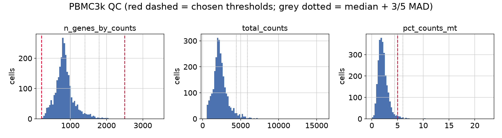
*Figure S1. QC metric distributions with chosen thresholds (red) and median + 3/5 MAD (grey).*

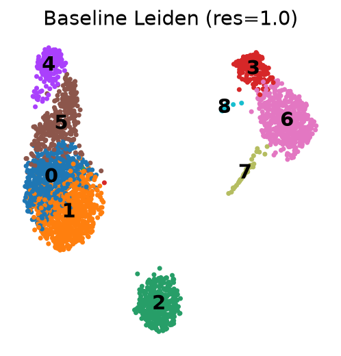
*Figure S2. Baseline UMAP coloured by Leiden cluster (resolution 1.0, seed 0).*

## 2.2 Marker-based annotation (S2)

**Method.**
1. Wilcoxon one-vs-rest markers computed from the PBMC3k data, used to describe each cluster (`table_s2a`, top 10 in `table_s2b`).
2. A rule-based label: the mean z-scored expression of literature marker sets per cluster, with the cluster assigned to the best-scoring set.
3. If the top two scores differ by < 0.15, the cluster is reported as *ambiguous* rather than forced into one label.

The marker sets are biological prior knowledge (references below). They were applied only *after* unsupervised clustering, and no reference labels were used (`common.py: MARKERS, auto_annotate`).

| Cluster (n) | Top data-derived markers (log2FC) **[Obs]** | Label | Supporting biology **[Ext]** |
|---|---|---|---|
| 0 (508) | IL32 2.3, LTB 2.1, CD3D 2.2, IL7R 1.9, CD2 1.8 | Memory CD4 T | IL7R⁺ S100A4⁺ IL32⁺ memory T (Zheng 2017; Hao 2021) |
| 1 (643) | ribosomal genes, LDHB 1.9, CD3D 1.9, NOSIP 1.8; CCR7 in 44 % of cells | **Naive T, CD4/CD8 mixed (revised)** | CCR7⁺ SELL⁺ LEF1⁺ naive T (Hao 2021); see S5 |
| 2 (342) | CD79A 7.8, MS4A1 6.4, CD79B 5.5, HLA-DQA1 5.3 | B | CD79A/B, MS4A1 (CD20) (Zheng 2017) |
| 3 (157) | FCGR3A 5.5, LST1 5.2, AIF1 4.9, IFITM3 4.8 | FCGR3A⁺ (non-classical) monocyte | FCGR3A, MS4A7, LST1 (Villani 2017) |
| 4 (155) | GNLY 7.9, GZMB 7.7, NKG7 6.9, PRF1 6.3, FGFBP2 6.6 | NK | GNLY, NKG7, cytotoxic granule genes (Zheng 2017) |
| 5 (306) | CCL5 5.6, NKG7 5.1, GZMK 4.9, CD3D 2.2; CD8A in 51 % | CD8 T (effector-memory-like) | CD8A/B, GZMK, CCL5 (Hao 2021) |
| 6 (475) | S100A8 7.6, S100A9 7.4, LYZ 6.2, FCN1 5.6 | CD14⁺ (classical) monocyte | CD14, LYZ, S100A8/9 (Villani 2017) |
| 7 (38) | FCER1A 8.7, CST3 4.9, HLA-DP/DQ/DR | Dendritic cell (likely cDC2) | FCER1A, CD1C, CLEC10A on cDC2 (Villani 2017) |
| 8 (14) | PPBP 13.0, PF4 12.9, NRGN 9.1 | Platelet / megakaryocyte | PPBP, PF4 (Zheng 2017) |

*Table S2. Baseline annotation (`table_s2d_baseline_annotation.csv`, marker-set scores in `table_s2c`). The revised cluster-1 label exists only in this report; the output tables, the annotated UMAP, Figs S4–S6 and the label-agreement metrics keep the automatic label "Naive CD4 T", so that every metric uses the rule's labels.*

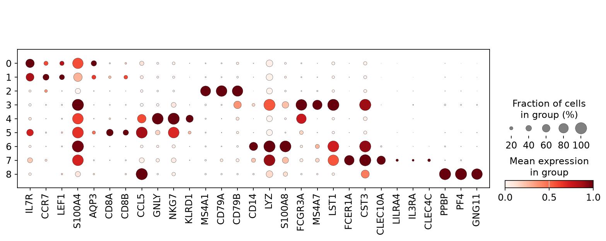
*Figure S3. Canonical marker expression per baseline cluster (dot size = fraction of cells expressing; colour = scaled mean). Feature UMAPs: `umap_s2d_marker_feature_plots.png`; annotated UMAP: `umap_s2b_baseline_annotated.png`.*

## 2.3 Resolution robustness (S3)

Leiden was re-run at **0.3, 0.6, 1.0 and 1.4** on the same kNN graph with the same seed, so only the resolution changed.

| Resolution | Clusters | ARI vs 1.0 | NMI vs 1.0 |
|---|---|---|---|
| 0.3 | 5 | 0.59 | 0.77 |
| 0.6 | 7 | 0.64 | 0.82 |
| 1.0 | 9 | 1 | 1 |
| 1.4 | 11 | 0.70 | 0.80 |

*Table S3a (`table_s3b/c`).* Splits and merges (≥ 10 % of a parent cluster, `table_s3d`) **[Obs]**:
- 0.3 → 0.6: the monocyte cluster (671 cells) splits into CD14⁺ (69 %) and FCGR3A⁺ (26 %).
- 0.6 → 1.0: the T cluster (1,187) splits into memory CD4 (43 %) and naive (54 %), and NK/CD8 (426) splits into CD8 T (63 %) and NK (36 %). 11 % of the FCGR3A-monocyte cluster (176) moves to CD14 monocytes.
- 1.0 → 1.4: the naive and memory CD4 clusters each split into further sub-clusters, with cells exchanged between them (14 % and 18 %).

| Baseline label | 0.3 | 0.6 | 1.0 | 1.4 |
|---|---|---|---|---|
| B | 1.00 | 1.00 | 1 | 1.00 |
| NK | 1.00 | 1.00 | 1 | 1.00 |
| CD14 Mono | 1.00 | 0.96 | 1 | 0.92 |
| Platelet | 0.93 | 0.93 | 1 | 1.00 |
| FCGR3A Mono | 0 | 1.00 | 1 | 1.00 |
| DC | 0 | 0.92 | 1 | 1.00 |
| CD8 T | 0 | 0 | 1 | 0.91 |
| Memory CD4 T | 0 | 0 | 1 | 0.82 |
| Naive CD4 T | 0 | 0 | 1 | 0.72 |

*Table S3b. Fraction of each baseline population receiving the same label at each resolution (`table_s3e`). This measures recall only: a label scores 1.00 even when its cluster also absorbs other populations (see purity below).*

**Interpretation.**
- **B cells are resolution-stable** (recall and purity 1.00 at every resolution). NK cells and CD14 monocytes keep their label, but only as *receiving* labels at low resolution. At 0.3 and 0.6, the "NK" cluster is 62–64 % CD8 T cells (purity 0.36–0.38). At 0.3, the "CD14 Mono" cluster also absorbs all FCGR3A monocytes and DCs (purity 0.71). Platelets are recovered at every resolution (0.93–1.00). FCGR3A monocytes and DCs need a resolution of at least 0.6.
- **CD8 T, naive CD4 and memory CD4 labels exist only at ≥ 1.0.** Even at 1.4, the naive/memory boundary moves (72 %/82 % kept).
- A seed-only control (resolution 1.0, seeds 1–5) gave ARI 0.77–0.83 vs seed 0, always with 9 clusters (`table_s3f`). Part of this comes from stopping Leiden after 2 iterations (the scanpy default): run to convergence with seed 0, it gives ARI 0.94 vs the baseline. Across seeds, all 9 labels are always present; B, NK, CD14 Mono, DC and platelet keep ≥ 0.99 of their cells, FCGR3A Mono 0.96–1.00 and CD8 T 0.90–0.97. Nearly all the change is at the naive/memory boundary (0.70–0.93; `table_s3f`). This supports §2.5.

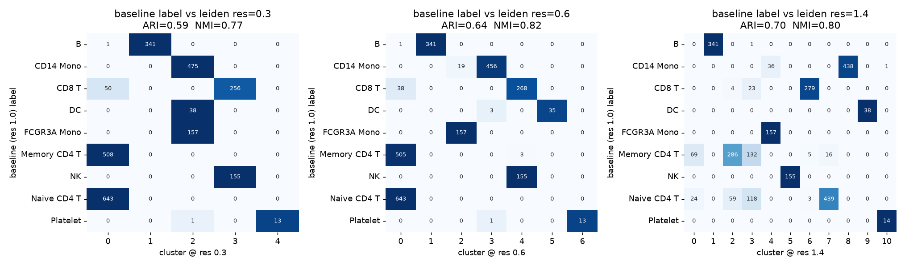
*Figure S4. Baseline labels (rows) vs clusters at other resolutions (columns); cell counts annotated. UMAPs per resolution: `umap_s3b_resolutions.png`.*

## 2.4 Downsampling robustness (S4)

**70 % of QC-passed cells (1,847 / 2,638), drawn with numpy `default_rng(42)`.** The full pipeline (normalisation, HVG selection, PCA, kNN, Leiden at 1.0, annotation rule) was re-run from raw counts. 1,496 of the 2,000 HVGs overlapped with the baseline set.

| Metric (1,847 shared cells) | Value |
|---|---|
| Clusters (baseline → subsample) | 9 → 7 |
| ARI / NMI (clusters) | 0.65 / 0.75 |
| Label agreement | 77.6 % |

*Table S4. Downsampling summary (`table_s4a`).*

Per-label agreement **[Obs]**:
- B 0.99, NK 1.00, CD14 Mono 0.95, FCGR3A Mono 0.95, naive T 0.87, DC 0.78, memory CD4 0.69.
- **CD8 T 0.00 and platelet 0.00**: at the same resolution, the 207 shared CD8 T cells split between NK (113, 55 %) and memory CD4 (88, 43 %). The 8 retained platelets were absorbed into the FCGR3A-monocyte cluster, plausibly as platelet–monocyte aggregates.
- Overlap of the top-20 markers (Jaccard): B and CD14 Mono 1.00, DC and naive T 0.90, FCGR3A Mono 0.67, memory CD4 and NK 0.54. NK's low value is a side effect of CD8 T cells joining the NK cluster.

**Is the CD8 loss an artifact? (`table_s4d/e`).**
- Re-clustering the *same* subsample at resolution 1.2 recovers a CD8 T cluster (8 clusters, label agreement 80.6 %).
- Five further subsample seeds at resolution 1.0 recover CD8 T every time (8–9 clusters, label agreement 81–85 %).
- The platelet cluster was recovered in only 1 of those 5 seeds.

**Conclusion.** The CD8/NK separation is real but sits close to the resolution threshold. The platelet population (14 cells) is too small to survive 30 % cell loss.

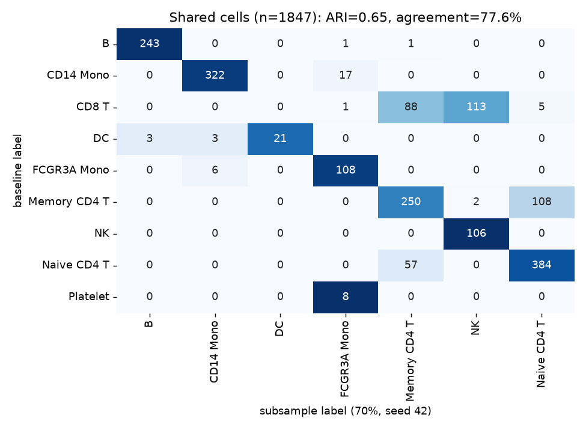
*Figure S5. Baseline vs subsample labels on shared cells. UMAPs: `umap_s4b_downsample.png`.*

## 2.5 Ambiguous population: naive vs memory CD4 T (S5)

**Why this population.** The naive/memory boundary is the least stable split in S3 and S4: 72 % / 82 % kept at 1.4, 69 % agreement for memory CD4 after downsampling, and most of the seed-to-seed variation (§2.3).

**Marker comparison [Obs].**

| Gene (% of cells detected) | Cluster 0 "memory" | Cluster 1 "naive" | Cluster 5 CD8 T |
|---|---|---|---|
| CCR7 / SELL / LEF1 | 27 / 51 / 28 | **44 / 60 / 35** | 6 / 31 / 7 |
| S100A4 / IL32 / AQP3 | **91 / 91 / 38** | 69 / 78 / 26 | 96 / 96 / 19 |
| CD4 | 12 | 9 | 4 |
| CD8A / CD8B | 6 / 9 | **14 / 23** | 51 / 38 |
| GZMK / CCL5 | 9 / 28 | 5 / 18 | 57 / 97 |

*Table S5 (`table_s5b`).* The direct Wilcoxon test of cluster 1 vs cluster 0 (`table_s5a`) shows only modest differences:
- Higher in cluster 1: ribosomal protein genes (log2FC 0.25–0.5).
- Higher in cluster 0: S100A4 (−1.7), S100A11 (−1.5), ANXA1 (−1.1), IL32 (−1.0).

**Evidence of a continuum rather than two discrete types [Obs].**
- The naive-minus-memory score has a **bimodality coefficient of 0.39**, below the 0.555 threshold for bimodality, and the two clusters' distributions overlap (Fig. S6). The score separates the two clusters only moderately (AUC 0.73). This is a weak test on its own: two populations whose means differ by under 1 SD, as here (−1.31 vs −0.70, SD ≈ 0.72), would also look unimodal. The kNN mixing below is the more direct evidence.
- In the kNN graph, 21 % (cluster 0) and 16 % (cluster 1) of each cell's edge weight points to the *other* cluster.
- Separately, **26 % of cluster-1 cells express CD8A or CD8B**. That compares with 3 % in B cells and 10 % in NK cells (background) and only 60 % in the true CD8 T cluster 5 (`table_s5d`). Correcting for both the background and the 60 % detection rate gives an estimated **31–40 % CD8 T cells in cluster 1** (`table_s5c`). The 10 % of cells that are CD8⁺ CCR7⁺ GZMK⁻ CCL5⁻ (a naive CD8 phenotype) is a lower bound, since CCR7 is itself detected in only 44 % of cluster-1 cells. CD4 transcript is detected in only 9–12 % of CD4 T cells.

**Explanation [Pred].**
- Naive → central memory → effector memory CD4 T cells form a continuous differentiation path. Graded genes (CCR7, SELL vs S100A4, IL32) and generally lower naive-cell transcription, which gives relatively more ribosomal reads, produce a gradient rather than a gap.
- Naive CD8 T cells share the CCR7/SELL/LEF1 naive programme and do not express cytotoxic genes. They therefore co-cluster with naive CD4 cells rather than with the effector-like CD8 cluster 5.
- Because CD4 mRNA drops out in about 90 % of cells, "CD4" is inferred mostly from the *absence* of CD8, which is unreliable in sparse 3′ data.

**Unresolved.**
- Whether central-memory cells sit in cluster 0 or 1.
- The exact CD4/CD8 make-up of cluster 1.

Protein-level data (CITE-seq for CD45RA/CD45RO, CD4, CD8) would be needed to settle either. We therefore relabel cluster 1 as **"Naive T, CD4/CD8 mixed"**. It is probably majority CD4, but up to about 40 % CD8.

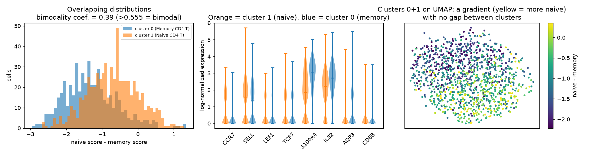
*Figure S6. Left: naive-minus-memory score per cell. Middle: key markers by cluster (orange = cluster 1, blue = cluster 0). Right: the score on the UMAP for clusters 0 and 1 (colour scale = 5th–95th percentile). There is a broad naive-to-memory gradient across the UMAP but no gap between the clusters.*

**Robust vs choice-dependent conclusions.**
- *Robust:* the major lineages (T/NK, B, myeloid) and the B-cell identity. NK and CD14-monocyte cells are always labelled correctly, but at low resolution their clusters also contain other cells.
- *Depends on parameters:* the CD8 T vs NK split and the FCGR3A-monocyte and DC split.
- *Depends on sampling:* the 14-cell platelet cluster. It is stable across resolutions but lost in 4 of 5 subsamples.
- *Not robust:* any discrete naive vs memory CD4 boundary.

## 2.6 Agent audit — Task 2

**Resources.**
- Data: PBMC3k filtered matrix (10x Genomics via the course repo; SHA-256 847d6e…).
- Software: scanpy 1.12.5, anndata 0.13.4, leidenalg 0.12.0, igraph 1.0.0, scikit-learn 1.9.1.
- Literature for marker biology: Zheng 2017 (PMID 28091601), Hao 2021 (PMID 34062119), Villani 2017 (PMID 28428369); methods: Wolf 2018 (PMID 29409532), Traag 2019 (PMID 30914743).
- No cell-type database or reference label set was used.

| Computed | Retrieved |
|---|---|
| QC metrics, thresholds, normalisation, HVG, PCA, kNN, UMAP, Leiden | Canonical marker-gene lists (literature) |
| Wilcoxon markers; marker-set scores; ARI/NMI; contingency tables | Cell-type biology linking markers to identities |
| Subsampling, seed sweeps, bimodality coefficient, kNN mixing | — |

**Independent checks run (with results).**
1. Seed-only control: changing only the Leiden seed gives ARI 0.77–0.83, which puts the resolution and subsample effects in context. Leiden run to convergence gives ARI 0.94, so most of that variation is due to the 2-iteration default.
2. The CD8 T loss after downsampling was checked with five extra seeds and a resolution sweep. Result: it is threshold-related, not an absent population.

> **Student verification (to complete):** open `table_s2b_top10_markers.csv` and confirm, without reading Table S2, that you would assign the same identity to clusters 2, 4 and 6. Then rerun `03_downsample.py` and confirm the 77.6 % agreement reproduces. Record your result here.

**Weaknesses found.**
- *Mis-labelled population.* The automatic rule labelled cluster 1 "Naive CD4 T", but 26 % of its cells express CD8A/B (about 31–40 % once corrected for detection). The first version of this report called the cluster "CD4-dominant". An independent review pointed out that this ignored CD8 dropout, and the label was changed to "mixed". The marker-set rule cannot see mixtures, and CD4 dropout makes "CD4" an inference from absence. The label was revised (§2.5).
- *Post-hoc baseline resolution.* The agent first used 0.6, saw that CD8 T and NK merged, and switched to 1.0. This is a researcher degree of freedom; it is disclosed here and made visible by the full sweep in S3.
- *Misleading figure (fixed).* In the first version of Fig. S6, the violin colours were the reverse of the histogram colours (naive was blue in one panel and orange in the other). It was corrected so both panels use orange for naive and blue for memory. A later review found the third panel still used a red/blue map clipped at ±1.5 around 0, while the data are centred near −1, so most cells saturated. It now uses a sequential map scaled to the data, and the title was softened from "graded, not split".
- The regress-out step follows the Seurat-style tutorial convention. It is not universally recommended and was not varied here.

# Task 3 — Spatial transcriptomics (Visium V1 Adult Mouse Brain)

## 3.1 Expression-only domains (T1)

**Input:** `V1_Adult_Mouse_Brain_filtered_feature_bc_matrix.h5` and `V1_Adult_Mouse_Brain_spatial.tar.gz` (course repository copies of 10x Genomics data; SHA-256 verified). There were 2,702 in-tissue spots × 32,285 genes.

**QC (Fig. T0, `fig_t0_qc_histograms.png`).**
- ≥ 5,000 UMIs, ≥ 1,000 genes, < 30 % mitochondrial; genes detected in ≥ 10 spots.
- Result: **2,683 spots × 17,535 genes**.
- The mitochondrial fraction is high in brain tissue (median 15.3 %, 99th percentile 28 %). A strict cut-off would preferentially remove whole anatomical regions, so only outliers were removed.

**Expression-only clustering.**
- `01_expression_domains.py` builds a new AnnData from the count matrix only. It contains no `obsm['spatial']`, no `uns['spatial']`, no array row/column and no image, and the script **asserts** that none of these fields is present.
- Steps: seurat_v3 HVG (2,000, on raw counts) → normalize_total to 10⁴ → log1p → scale → PCA (30 PCs) → kNN (k = 15) → Leiden (resolution 0.5, igraph), seed 0.
- Coordinates are re-attached only after the labels exist.

| Domain | 0 | 1 | 2 | 3 | 4 | 5 | 6 | 7 | 8 | 9 | 10 | 11 | 12 | 13 | 14 | 15 |
|---|---|---|---|---|---|---|---|---|---|---|---|---|---|---|---|---|
| Spots | 330 | 89 | 207 | 339 | 201 | 254 | 201 | 115 | 245 | 77 | 92 | 247 | 42 | 20 | 28 | 196 |

*Table T1. 16 expression domains (`table_t1_domain_sizes.csv`; top markers in `table_t1c`).*

**Tentative anatomy [Pred/Ext]**, based on marker genes vs the Allen Mouse Brain Atlas (Lein et al. 2007, PMID 17151600) and not checked image by image:
- 2/3/15: cortical layers (Lamp5; Satb1/Snap25; Tbr1)
- 4 and 5: thalamus (Tcf7l2, Slc17a6; Prkcd)
- 8: fibre tracts (Mbp, Plp1, Mobp)
- 11/12/13: hippocampus (Camk2a/Ddn; CA1 Fibcd1/Spink8; dentate gyrus C1ql2/Dsp)
- 6: hypothalamus (Resp18, Hap1, Baiap3)
- 10: hypothalamus *or* amygdala (Hap1, Baiap3; it is a lateral band next to domain 0, not adjacent to domain 6), uncertain
- 14: ependyma/ventricle (Tmem212, Ccdc153)
- 9: meninges/vascular (Ptgds, Mgp)
- 1: striatum-like (Ppp1r1b, Penk, Adora2a). Ttr is its #2 marker and its mean Ttr is the highest of any domain, so it probably also contains choroid plexus or ventricle spots
- 0 and 7: not annotated with confidence. Domain 0 (Nptxr, Lmo3, Slc30a3; ventrolateral) might be piriform cortex, amygdala or cortical subplate. Domain 7 (Gad2, Vamp1, Hcn2; between thalamus and hypothalamus) might be reticular nucleus or zona incerta
- The cortical-layer evidence is weak: Snap25 is pan-neuronal

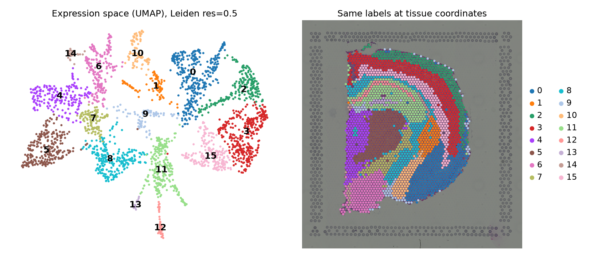
*Figure T1. The same expression-derived labels and colours in expression space (UMAP, left) and at tissue coordinates over the H&E image (right). Per-domain maps: `fig_t1b_domains_small_multiples.png`.*

## 3.2 Quantitative spatial organisation (T2)

**Spatial graph.** squidpy `spatial_neighbors(coord_type="grid", n_neighs=6, n_rings=1)` on the spot-centre coordinates (`obsm["spatial"]`). This gives exactly the same 7,759 edges as building the hexagonal lattice by hand from (array_row, array_col), which a reviewer checked independently. Each spot connects to its up-to-6 physically adjacent spots in the hexagonal lattice, about 100 µm centre-to-centre.
- Only the 2,683 in-tissue spots that passed QC are nodes, so off-tissue and removed spots can never be neighbours. Edge spots simply have fewer neighbours.
- The graph has 7,759 undirected edges and mean degree 5.78; 2,390 spots have degree 6.

**Statistics [Obs].**
- **Global same-domain edge fraction** (the share of physical-neighbour pairs in the same expression domain) is **0.783**. Random labelling with the same domain sizes would give 0.084 (analytic expectation, confirmed by the null).
- Per-domain self-adjacency is 9.97–97.7× the null mean for every domain (`table_t2a`).
- **Moran's I of each domain's 0/1 indicator** is 0.34–0.88, all with permutation p = 0.001 (`table_t2d`). These use binary weights, whereas the gene Moran's I in §3.3 uses row-normalised weights.
- **Neighbourhood enrichment** z-scores (1,000 permutations) are strongly positive on the diagonal (Fig. T3). The strongest *between-domain* contacts are hippocampal 11–12 (z = 24.4) and 11–13 (15.6), hypothalamus–ependyma 6–14 (7.7), and fibre tract–ependyma 8–14 (4.3).

**Interpretation.** Higher values mean that physical neighbours are more often transcriptionally alike. A value of 0.78 means most neighbouring spots share a domain, and enriched off-diagonal pairs reflect domains that share borders, such as the hippocampal sub-fields. This shows spatial *coherence*. It does not by itself show a mechanism.

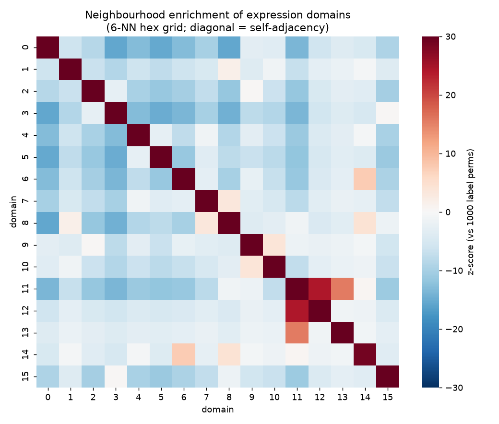
*Figure T3. Neighbourhood-enrichment z-scores between expression domains.*

## 3.3 Spatially variable genes (T3)

**Gene set.** The top 200 HVGs by seurat_v3 rank from the expression-only step, with mitochondrial genes excluded (`table_t3a`). **Method:** Moran's I on the same 6-neighbour graph (row-normalised weights), analytic p-values, Benjamini–Hochberg FDR.

**Results [Obs].**
- All 200 genes have FDR < 0.05. Testing only HVGs selects for structured genes, so this is expected.
- Top-ranked genes: **Prkcd (I = 0.872), Mbp (0.871), Ttr (0.868), Pmch (0.850), Tcf7l2 (0.835), Mobp (0.829), Agrp (0.813), Tnnt1 (0.802)**.
- Lowest-ranked genes: Ccl5 (0.02), S100a8/9 (0.10), Myl9 (0.13), Vwf (0.18). These are blood-cell and vascular genes found in scattered spots.

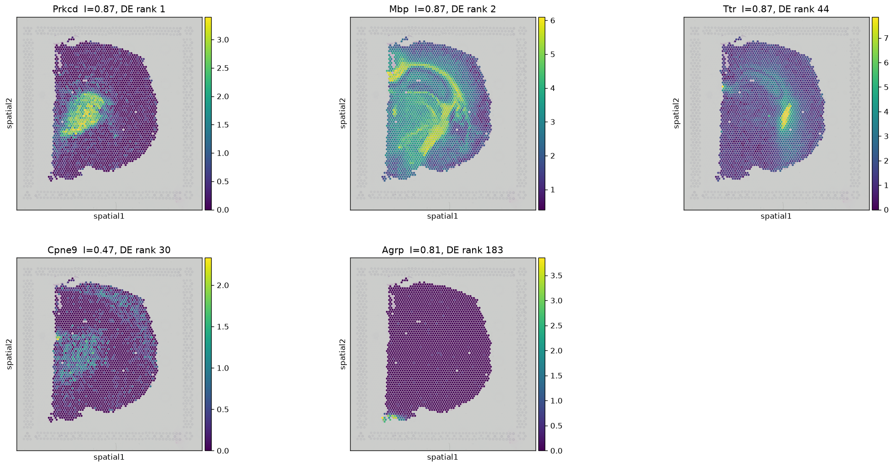
*Figure T4. Selected genes on tissue. Prkcd = thalamus, Mbp = fibre tracts, Ttr = choroid plexus/ventricle, Cpne9 = graded, Agrp = concentrated in the arcuate region (detected in 118 spots across 15 domains, 50 of them in domain 6).*

## 3.4 Differential expression vs spatial ranking (T4)

**DE method.** Wilcoxon one-vs-rest across the 16 domains (scanpy), on the *same 200 genes*. A gene's DE strength is its best z-score over domains. Spearman ρ between Moran's I and DE z = **0.52** (p = 1.5 × 10⁻¹⁵). The domains were defined from these same HVGs, so DE p-values are circular and are not used as evidence, only the ranking. **Sensitivity to the DE metric:** ranking DE by effect size (max log2FC over domains) instead of z lowers ρ to **0.29** (`table_t4b`), and individual ranks move a lot (Agrp 183 → 27, Prkcd 1 → 41, Mbp 2 → 102). The "DE rank" below is the z-based one, so the categories describe the Wilcoxon ranking, not DE in general.

| Category | Example (Moran's I rank / DE rank; best domain; % spots detected) | Why **[Pred]** |
|---|---|---|
| High in both | Prkcd (1/1; thalamus D5; 53 %), Mbp (2/2; fibre tract D8; 100 %), Mobp, Plp1 | The gene marks a large, contiguous region that matches a domain |
| Spatial-high / DE(z)-low | **Agrp (7/183; 4 %)**, Gm5741 (10/190; 4 %), Fezf1 (22/161; 5 %) | Expressed in tiny nuclei (Agrp: arcuate; Fezf1: ventromedial hypothalamus) that are smaller than any domain. Neighbouring spots agree, so Moran's I is high. The fold change is large (Agrp log2FC 5.5, rank 27 by log2FC), but most spots of the best domain are zero (about 75 % of domain 6 for Agrp), and the rank-based Wilcoxon z penalises that |
| DE-high / spatial-lower | Cpne9 (103/30), Necab2 (97/36), Rprm (80/40) | They separate domains on average but vary in a graded or patchy way within them, so local neighbour agreement is weaker |

*Table T3. Example genes in each category (`table_t3b_t4_moran_and_DE_rankings.csv`).*

The DE-high/spatial-low category is sparse. Only Cpne9 has a DE rank ≤ 30 and a spatial rank > 60. This is expected: the domains are themselves spatially coherent, so their markers tend to be spatial genes too.

**What each ranking measures.** Moran's I measures whether *physically adjacent* spots have similar expression, regardless of any clustering. DE measures how well a gene separates *predefined groups* averaged over all their spots, regardless of where they are. Ttr shows a technical side of this: it is detected in 99 % of spots despite being produced by the choroid plexus, which points to spot-to-spot signal spread (ambient RNA or diffusion).

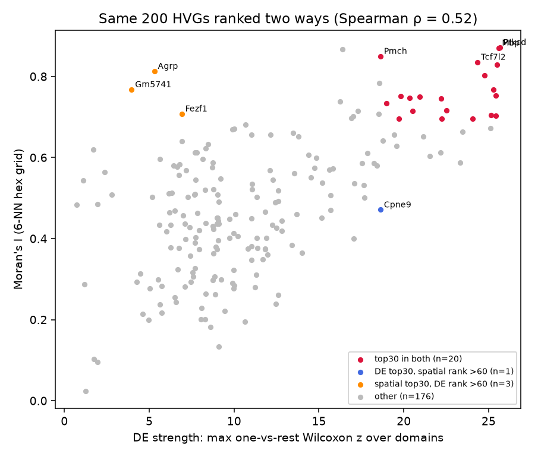
*Figure T5. DE strength vs Moran's I for the same 200 genes, with the three categories highlighted (`table_t3b_t4_moran_and_DE_rankings.csv`).*

## 3.5 Randomised negative control (T5)

**Null A (primary).** Domain labels are permuted across spots on the **fixed** spatial graph. This keeps the domain sizes and the graph identical and destroys only the label placement. **Null B (implementation check).** Spot positions are permuted and the 6-neighbour grid graph is **rebuilt** from the same coordinates in every repetition (the script asserts that each rebuilt graph has the observed 7,759 edges). Because spots are shuffled among a fixed set of positions, the rebuilt graph is the observed graph with relabelled nodes, so Null B is **equal in distribution to Null A**. It checks the graph-building code; it is *not* an independent null. Both use **1,000 repetitions**: Null A with seed 0 and Null B with seed 1 (numpy `default_rng`). The statistic is the global same-domain edge fraction in both cases. The test is one-sided (H₁: observed > null), because spatial coherence predicts *more* same-label adjacency. The empirical p-value is (1 + #null ≥ obs)/(N + 1).

| Statistic | Observed | Null A mean ± SD (max) | Null B mean ± SD (max) | z (A / B) | Empirical p (A / B) |
|---|---|---|---|---|---|
| Global same-domain edge fraction | **0.783** | 0.084 ± 0.003 (0.096) | 0.084 ± 0.003 (0.094) | 224 / 224 | **0.001 / 0.001** (no null value reached the observed one) |
| Same, after regressing out depth and % mito and re-clustering | 0.792 | 0.093 ± 0.003 | — | — | 0.001 |

*Table T4 (`table_t5a`, `table_t5c`). Per-domain observed vs null: `table_t2a`.*

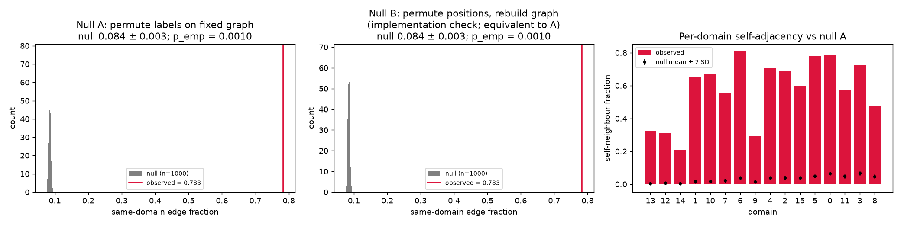
*Figure T6. Observed statistic (red) vs 1,000 randomisations under each null; right: per-domain self-adjacency vs null mean ± 2 SD.*

**Technical-confound check [Obs].**
- Sequencing depth and mitochondrial fraction are themselves spatially autocorrelated (Moran's I 0.49 and 0.58), and the domains explain 36 % and 31 % of their variance (η², Fig. T7).
- Regressing both out before PCA and re-clustering gives 13 domains with **ARI = 0.78** vs the original 16. The domain structure is therefore largely, not fully, stable. Domains 1 and 3 have the weakest one-to-one match: at most 67 % and 66 % of their spots go to any single new domain (`table_t5d`). The new domains are equally coherent (0.792 vs null 0.093).
- This check has limits. The domains explain about a third of the depth and mito variance, so regressing them out may also remove biology. Linear regression cannot remove non-linear technical effects. Depth is itself spatially smooth (Moran's I 0.49), so high coherence after regression is expected either way.

**Conclusion.** Expression-defined domains are strongly non-randomly organised in tissue space. This holds against the label-permutation null, and the domain structure is largely stable (ARI 0.78) after linear removal of depth and mito effects. It is consistent with real anatomical structure, but it does not show a mechanism.

**Limitations.**
1. The null (A, and its equivalent B) assumes *complete spatial randomness*, a weak alternative. A stronger null would preserve spatial autocorrelation, for example rotating or shifting the label map, or using spatially smoothed random labels. That was not done. Any smooth gradient, technical ones included, would beat them, so the p-value is limited by N (minimum 1/1,001), not by the effect size.
2. Visium spots (55 µm) mix several cells, and neighbouring spots share diffused transcripts (see Ttr), which inflates local similarity.
3. One tissue section was analysed, so there is no biological replicate.

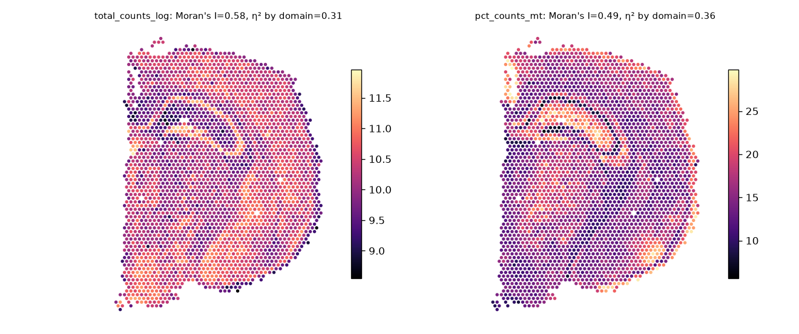
*Figure T7. Log total counts and % mito on tissue.*

## 3.6 Agent audit — Task 3

**Resources.**
- Data: 10x Genomics V1 Adult Mouse Brain filtered matrix + spatial archive (course repo; SHA-256 eb7837… and 46d6b0…).
- Software: scanpy 1.12.5, squidpy 1.8.4, scikit-misc (seurat_v3 HVG), scipy 1.18.1.
- Literature: Palla 2022 (squidpy, PMID 35102346), Lein 2007 (Allen Mouse Brain Atlas, PMID 17151600), Moran 1950 (Biometrika 37:17–23).

| Computed | Retrieved |
|---|---|
| QC, HVG, PCA, kNN, Leiden domains; UMAP | Anatomical meaning of marker genes (Allen Atlas / literature) |
| Hex-grid graph; same-domain edge fraction; nhood enrichment; Moran's I (domains and genes); BH FDR | — |
| Wilcoxon DE; Spearman comparison (z and log2FC); 1,000-repeat null plus its graph-rebuild implementation check; depth/mito confound re-clustering | — |

**Independent checks run (with results).**
1. Analytic check of the null. The expected same-label edge fraction under random labelling, Σnₖ(nₖ−1)/(N(N−1)) = 0.0844, matches the permutation mean of 0.0844. This confirms that the permutation code is unbiased.
2. Exclusion of coordinates from clustering is enforced by `assert` statements, not just stated.

> **Student verification (to complete):** pick two domains in Fig. T1 and compare their location with the Allen Brain Atlas coronal reference (atlas.brain-map.org) and the top markers in `table_t1c`. Record whether the anatomical labels in §3.1 hold up.

**Weaknesses found.**
- *Null B bug (found in review, fixed).* The first version of Null B rebuilt its graph from (array_row, array_col). On those coordinates squidpy's grid mode keeps only the 4 diagonal neighbours, so each null graph had 5,178 edges instead of 7,759. The observed statistic was being compared with a null on a different graph (the SD was inflated, giving z 182 instead of 224). Null B now uses the same coordinates and asserts an identical edge count. The review also pointed out that Null B is equivalent to Null A in principle, so it is now reported as an implementation check.
- *DE-metric dependence (found in review).* The z-based DE ranking was the only one reported. Ranking by log2FC lowers the agreement with Moran's I from 0.52 to 0.29, so the categories in §3.4 are specific to Wilcoxon z. This is now stated.
- *Weak null.* Label permutation only tests against complete spatial randomness. Because of this, the agent added the depth/mito confound check and states the limitation explicitly.
- *Gene-set dependence.* Testing only HVGs makes "200/200 significant" uninformative. The rankings are useful; the significance count is not.
- *Anatomical labels* are inferred from marker genes using prior knowledge, not checked against an atlas image by image, and are therefore tagged [Pred/Ext].
- *Category threshold.* The DE-high/spatial-low category depends on the rank cut-offs (top 30 vs > 60) and contains only one gene at those cut-offs. The softer examples (Necab2, Rprm) are listed as such.

# Reproducibility

- **Run order:** `bash submission/run_all.sh`. This creates `.venv`, downloads and checksums all data (`fetch_data.sh`), then runs single_cell 01→04, spatial 01→04, protein 01→03, and builds this report. The total time is about 4 minutes on a CPU.
- **Environment:** Python 3.12.3. Exact versions are in `requirements.txt`; key packages are scanpy 1.12.5, squidpy 1.8.4, anndata 0.13.4, leidenalg 0.12.0, numpy 2.5.4, pandas 3.1.0, scikit-learn 1.9.1, gemmi 0.7.5, biopython 1.88, freesasa 2.2.1 and pymol-open-source 3.2.
- **Seeds:**
  - Task 2: seed 0 for PCA, kNN, Leiden and UMAP; subsample seed 42; extra Leiden seeds 1–5; extra subsample seeds 1–5.
  - Task 3: seed 0 for clustering and Null A; seed 1 for Null B; 1,000 permutations.
  - Task 1: deterministic, no randomness.
- **Data accessions:**
  - 10x Genomics PBMC3k and V1_Adult_Mouse_Brain, via the course repository GenAIBioMed/GenAIBioMedAssignment3 `datasets/`.
  - UniProt P00533, P04626, P21860, Q15303.
  - PDB 4HJO, 1M17, 2ITX, 2ITN, 2ITV, 2JIT, 4I22.
  - AlphaFold DB AF-P00533-F1 v6.

# References (all verified via PubMed E-utilities, 2026-10-29)

1. Cheng J, et al. Accurate proteome-wide missense variant effect prediction with AlphaMissense. *Science* 2023;381:eadg7492. PMID 37733863.
2. Gajiwala KS, et al. Insights into the aberrant activity of mutant EGFR kinase domain and drug recognition. *Structure* 2013;21:209–219. PMID 23273428.
3. Hao Y, et al. Integrated analysis of multimodal single-cell data. *Cell* 2021;184:3573. PMID 34062119.
4. Jumper J, et al. Highly accurate protein structure prediction with AlphaFold. *Nature* 2021;596:583–589. PMID 34265844.
5. Kobayashi S, et al. EGFR mutation and resistance of non-small-cell lung cancer to gefitinib. *N Engl J Med* 2005;352:786–792. PMID 15728811.
6. Lein ES, et al. Genome-wide atlas of gene expression in the adult mouse brain. *Nature* 2007;445:168–176. PMID 17151600.
7. Lynch TJ, et al. Activating mutations in the EGFR underlying responsiveness of NSCLC to gefitinib. *N Engl J Med* 2004;350:2129–2139. PMID 15118073.
8. Paez JG, et al. EGFR mutations in lung cancer: correlation with clinical response to gefitinib therapy. *Science* 2004;304:1497–1500. PMID 15118125.
9. Palla G, et al. Squidpy: a scalable framework for spatial omics analysis. *Nat Methods* 2022;19:171–178. PMID 35102346.
10. Pao W, et al. Acquired resistance of lung adenocarcinomas to gefitinib or erlotinib is associated with a second mutation in the EGFR kinase domain. *PLoS Med* 2005;2:e73. PMID 15737014.
11. Park JH, Liu Y, Lemmon MA, Radhakrishnan R. Erlotinib binds both inactive and active conformations of the EGFR tyrosine kinase domain. *Biochem J* 2012;448:417–423. PMID 23101586.
12. Shan Y, et al. Oncogenic mutations counteract intrinsic disorder in the EGFR kinase and promote receptor dimerization. *Cell* 2012;149:860–870. PMID 22579287.
13. Stamos J, Sliwkowski MX, Eigenbrot C. Structure of the EGFR kinase domain alone and in complex with a 4-anilinoquinazoline inhibitor. *J Biol Chem* 2002;277:46265–46272. PMID 12196540.
14. Traag VA, Waltman L, van Eck NJ. From Louvain to Leiden: guaranteeing well-connected communities. *Sci Rep* 2019;9:5233. PMID 30914743.
15. Villani AC, et al. Single-cell RNA-seq reveals new types of human blood dendritic cells, monocytes, and progenitors. *Science* 2017;356:eaah4573. PMID 28428369.
16. Wolf FA, Angerer P, Theis FJ. SCANPY: large-scale single-cell gene expression data analysis. *Genome Biol* 2018;19:15. PMID 29409532.
17. Yun CH, et al. Structures of lung cancer-derived EGFR mutants and inhibitor complexes: mechanism of activation and insights into differential inhibitor sensitivity. *Cancer Cell* 2007;11:217–227. PMID 17349580.
18. Yun CH, et al. The T790M mutation in EGFR kinase causes drug resistance by increasing the affinity for ATP. *Proc Natl Acad Sci USA* 2008;105:2070–2075. PMID 18227510.
19. Zhang X, et al. An allosteric mechanism for activation of the kinase domain of epidermal growth factor receptor. *Cell* 2006;125:1137–1149. PMID 16777603.
20. Zheng GX, et al. Massively parallel digital transcriptional profiling of single cells. *Nat Commun* 2017;8:14049. PMID 28091601.
